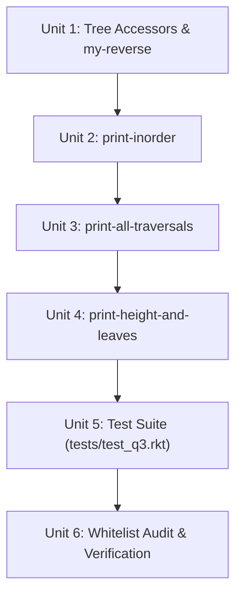

Changes made to test vidith's account!

## 1. Problem Specification Summary

A binary tree is either `'()` (empty) or a 3-element list `(value left right)` where `left` and `right` are binary trees.

### Required Tasks
1. **S1.a `(print-inorder tree)`**: Prints on one line using `display` the list of values in inorder (left, root, right) followed by `(newline)`.
2. **S1.b `(print-all-traversals tree)`**: Prints three lines using `display`:
   - Line 1: Inorder list `(left, root, right)`
   - Line 2: Preorder list `(root, left, right)`
   - Line 3: Postorder list `(left, right, root)`
   Each line ends with `(newline)`.
3. **S1.c `(print-height-and-leaves tree)`**: Prints on one line using `display` the list `(height leaf-count)` followed by `(newline)`.
   - Empty tree `'()` has height `0` and `0` leaves.
   - Single node tree has height `1` and `1` leaf.

---

## 2. Constraints & Whitelist Check

* **Strict Whitelist (Allowed Only):**  
  `define`, `lambda`, `let`, `let*`, `letrec`, named `let`, `if`, `cond` (with `else`), `and`, `or`, `not`, `begin`, `'` / `quote`, `cons`, `car`, `cdr`, `list`, `c[ad]{1,4}r` compositions (`cadr`, `caddr`, etc.), `null?`, `pair?`, `eq?`, `assq`, `assoc`, `+ - * < > <= >= =`, `max`, `display`, `newline`.
* **Strictly Forbidden:**  
  `length`, `append`, `reverse`, `map`, `filter`, `foldl`, `foldr`, `member`, `set!`, loops (`do`, `for`), `when`, `unless`, `equal?`, `list?`.
* **Environment Rules:**  
  - Starts with `#lang racket/base`.
  - Only function definitions; file must be completely **silent on load** (grader appends calls).
  - All state passed via arguments (pure functional, tail-recursive where natural).

---

## 3. Decomposed Step-by-Step Workflow

In accordance with the **Decomposition Rule** (1 prompt = 1 unit of work = 1 atomic commit):



| Step | Unit of Work | Target Function(s) | Prompt File | Git Commit Message |
| :--- | :--- | :--- | :--- | :--- |
| **1** | Core helpers & accessors | `tree-val`, `tree-left`, `tree-right`, `my-reverse` | `prompts/S1.md` (Prompt 1) | `S1: add tree accessors and my-reverse helper` |
| **2** | S1.a Inorder | `inorder-collect`, `print-inorder` | `prompts/S1.md` (Prompt 2) | `S1: add print-inorder` |
| **3** | S1.b Preorder & Postorder | `preorder-collect`, `postorder-collect`, `print-all-traversals` | `prompts/S1.md` (Prompt 3) | `S1: add print-all-traversals` |
| **4** | S1.c Height & Leaves | `tree-metrics`, `print-height-and-leaves` | `prompts/S1.md` (Prompt 4) | `S1: add print-height-and-leaves` |
| **5** | Automated Tests | Create `tests/test_q3.rkt` covering PDF cases ($t_1, t_2, t_3$, `'()`) & edge cases | `prompts/S1.md` (Prompt 5) | `S1: add test suite for tree traversals` |
| **6** | Verification & Audit | Whitelist validation & silent load check | `prompts/S1.md` (Prompt 6) | `S1: verify whitelist compliance and silent loading` |

---

## 4. Verification Strategy

1. **Silent Load Check:**
   ```bash
   racket code/18_q3.rkt
   # Must produce zero output
   ```

2. **Automated Test Run:**
   ```bash
   cat code/18_q3.rkt tests/test_q3.rkt > /tmp/run_q3.rkt && racket /tmp/run_q3.rkt
   ```

3. **Whitelist Symbol Audit:**
   Scan `code/18_q3.rkt` to guarantee zero prohibited symbols (`append`, `length`, `reverse`, `map`, `set!`, `filter`, etc.).
